# How Agent Swimlane works

Agent Swimlane turns your saved Codex history into an inspectable execution trace. It reads evidence that already exists, reconstructs relationships, and draws several views of the same data. It does not launch agents, submit prompts, replay tools, or measure hardware counters.

## 1. The complete data path

### Refinements: shared mapping, compact lanes, and net time

The pipeline now has two raw-source adapters (`swimlane/codex.py`, `swimlane/claude.py`), a semantic mapping module (`swimlane/mapping.py`), common case assembly (`swimlane/cases.py`), shared activity derivation, and a source-independent renderer. Claude `tool_use`/`tool_result` blocks become common tool envelopes; assistant message IDs deduplicate response blocks. Provider-specific cache fields become inclusive common input totals before aggregation. The first Claude import includes three local CLI sessions. Explicit child relationships are required before child transcripts can become lanes; the selected local Claude sessions currently render as main-agent cases.

Activity indicators now occupy a thin colored strip within each compact agent row, rather than three duplicated resource bands. Response diamonds, tool details, and optional nested execution remain separate marks within that row. Different agents retain separate rows and can overlap in time.

`web/timeline.js` owns the reversible wall-clock/net-time coordinate transform. It merges the coverage of observed turns across agents and removes only uncovered gaps exceeding two minutes. Original event times are retained; SVG coordinates use the transformed time. Tick labels invert that transform to show actual dates/times. Omitted-gap markers expose removed durations. Gaps inside observed turns remain because the history does not establish that the user or harness was inactive. This is an observed-turn timeline, not a measurement of human working hours.

Mouse interaction uses the same transform for pointer location, panning, wheel zoom, range zoom (Shift-drag), and reset (double-click). The optional vertical cursor shows the original timestamp at its position. “First collaboration” chooses the first child-agent work window, while “All turns” resets to the entire trace under the selected time mode.

```mermaid
flowchart LR
    A[Local Codex JSONL / compressed JSONL] --> B[Discover and summarize sessions]
    B --> C[Select useful root sessions]
    C --> D[Attach explicit descendant threads]
    D --> E[Codex adapter: normalize records]
    E --> F[Derive workflow activity intervals]
    F --> G[Private JSON snapshots in data/]
    G --> H[Loopback HTTP server]
    H --> I[Browser: SVG lanes and charts]
    I --> J[Click event: content and source evidence]
```



There are two separate operations:

- **Import:** `python import_history.py` reads local source logs and writes a snapshot. This is when session selection, normalization, relationships, and activity classification are computed.
- **Explore:** `python serve.py` serves that snapshot and the web UI at `127.0.0.1:8765`. Selecting cases, filtering, zooming, or clicking events runs in the browser. It does not read the original Codex logs again.

This separation makes the viewer reproducible: the same imported snapshot produces the same analysis even if your live history later changes. To see new history, re-import and refresh.

## 2. Turning requirements into implementation

| Requirement | Implementation | Boundary of what it establishes |
| --- | --- | --- |
| Find interesting sessions | Scan roots with at least 10 tool calls and 3 direct response records; prioritize linked sub-agents | Selection is a useful sample, not a statistical benchmark |
| Count model rounds | Deduplicate direct usage records by response ID | A response is different from a user turn or tool call |
| Input/output sequence lengths | Preserve reported usage on each response | Token totals are available; exact request contents may not be |
| Show sub-agents | Link child session metadata to its explicit parent ID | Unlinked internal agents are not assigned by guesswork |
| Show communication | Match recorded author/recipient agent paths | Receipt time is known; transport latency is not |
| Show execution over time | SVG intervals and timestamp markers on a common axis | Width represents observed or explicitly inferred time |
| Explain prompt composition | Count visible stored characters by source/role | This is not the composition of each full model request |
| Show GPU/CPU/other activity | Derive workflow indicators from turns, responses, and tool envelopes | These are workflow categories, not processor utilization |

## 3. Discovery and case assembly

`import_history.py` enumerates only the `sessions` and `archived_sessions` directories under the selected Codex home. The adapter streams plain JSONL and Zstandard-compressed JSONL using `zstandard`. It records physical line numbers so each event can be traced back to its source.

The first pass creates a lightweight inventory: session ID, title, date, parent ID, call counts, usage-record counts, and file path. If two files represent the same thread, the importer retains the one with more direct usage records, then more calls. This is a pragmatic selection rule, not a merge of divergent histories.

After selecting roots, it follows explicit parent IDs to attach descendants. A case is therefore a root thread plus its available child threads. A child resumed later is still the same agent lane. No lane is invented because two unrelated logs happen to share a directory or timestamp.

The selected files are then parsed in detail. The original logs remain unchanged. Normalized snapshots and the inventory are written to Git-ignored `data/`.

## 4. The shared trace model

The central object is a **case** containing **agents**. Each agent contains:

- **Turns:** periods bounded by task-start/task-complete records. A turn may contain many responses and tools.
- **Rounds:** model responses with reported input, output, cache, and reasoning token counts.
- **Spans:** tool envelopes, nested executions, lifecycle records, and compaction.
- **Messages:** visible transcript text and inter-agent receipts.
- **Activities:** derived GPU/model-wait, CPU/tool, and other intervals.

The case also contains cross-agent **edges**, an optional initial focus range, aggregate usage, source paths, and limitations. Every inspectable event has an ID, agent ID, timestamp, confidence, and source provenance. The exact field contract is in [schema.md](schema.md).

This common representation is the extension point. A future Claude Code or OpenCode adapter would map its own records into these concepts. The frontend should not need to understand those harnesses' raw log formats. Activity derivation already operates on normalized events rather than Codex JSON.

## 5. Avoiding misleading counts

Codex can save the same usage through multiple record types. Counting both `token_usage_record` and mirrored `token_count` records would inflate totals. When direct usage records exist in a file, the adapter uses only those, once per response ID. In older files without them, distinct cumulative usage updates become an explicitly inferred fallback.

Tool calls and nested execution are also separate. For example, one `exec` model call may run two shell commands. The top-level tool count is one; the two shell executions can be displayed as extra detail. The viewer does not add these together and call the result three model-issued tools.

Cached input is a subset of input; reasoning output is a subset of output. Summing them again would double-count. Session input totals are accumulated over responses: 100 calls each processing 50,000 input tokens can total 5 million input tokens without ever having a 5-million-token context window.

## 6. GPU, CPU, and other activity indicators

The requested labels are useful for understanding the workflow, but the history contains no actual GPU/CPU counters. Inference typically happens remotely, and a tool can itself wait on a network service or run GPU code. The indicator names therefore describe the **stage of work**.

| Band | Display | How the interval is established |
| --- | --- | --- |
| GPU / model wait | Hatched green | Inferred response window after the previous response or latest human input, excluding recorded tool/wait/compaction intervals |
| CPU / tools | Solid blue | Recorded call/output or nested execution envelope |
| Other / explicit wait | Orange | Known wait/input tool's recorded envelope |
| Other / compaction | Purple | Explicit compaction span; internal CPU/model division unavailable |
| Other / unclassified | Gray | Time inside the observed turn that cannot be assigned, including incomplete tools |

### Interval construction

`swimlane/activity.py` processes each agent and each turn independently:

1. Establish the turn's observed range. If the turn has no completion record, stop at the last event for that turn, not the current clock time.
2. Collect closed tool and nested-execution intervals. Explicit wait tools and compaction receive their own category. An open tool has unknown duration and prevents claiming the remaining turn is inference.
3. For each response, create a candidate model-wait window from the preceding response timestamp, or turn start for the first response, to this usage timestamp. A later human input moves the start forward.
4. Split the turn at all candidate interval boundaries. For each small interval, choose evidence with this precedence: incomplete-tool uncertainty; explicit wait/compaction; tool execution; model-wait candidate; unclassified remainder.
5. Merge adjacent segments only when their classification and supporting evidence are identical.

This avoids counting a wrapper and nested execution twice in one agent's activity bands. It also prevents an overnight gap **between turns** from becoming a giant inference span. Long observation gaps inside a turn now become inferred stalls before other phase classification. Shorter inferred green windows can still include network latency, queueing, and harness work. Silence does not establish a specific cause.

### A concrete example

Suppose a turn starts at 0 s, a model issues a tool call at 25 s, usage is recorded at 30 s, the tool returns at 50 s, the next response is recorded at 80 s, and the turn ends at 100 s.

| Interval | Classification |
| --- | --- |
| 0–25 s | GPU/model-wait candidate |
| 25–50 s | CPU/tool envelope (even though usage is recorded at 30 s) |
| 50–80 s | GPU/model-wait candidate |
| 80–100 s | Other/unclassified |

The derived durations are 55 s of **candidate** model wait, 25 s of recorded tool envelope, and 20 s unclassified. A usage event at 30 s does not turn the ongoing 25–50 s tool span into model work. These figures are a partition of the observed workflow, not GPU/CPU utilization percentages.

### Overlap and preprocessing

Each band has one subtrack per agent, in the same order as the agent lanes. A main agent's blue tool interval and a reviewer's green inference candidate can therefore coexist at the same timestamp. We do not collapse the whole team into a single “current processor.”

Preprocessing and postprocessing have no separate boundaries in these logs. The tool leaves them unclassified when possible and explicitly notes that they may also be inside inferred model-wait windows. It does not manufacture CPU spans for them. Actual separation would require a live collector with request-start/end, context-build, serialization, dispatch, and result-ingestion events. Even then, actual hardware utilization would require separate host/provider telemetry.

Clicking an indicator shows its explanation, confidence, turn ID, source location, and links to supporting events. Hatched green always means inference; solid blue means recorded envelope boundaries, not proof of busy CPU cycles.

## 7. Browser rendering and interaction

`web/app.js` loads the index, then one selected case. It builds an event-ID lookup for the inspector. All time-based elements use the same mapping:

```text
x = plot_left + (event_time - visible_start)
                / (visible_end - visible_start) * plot_width
```

Zoom and pan change the visible range; turn selection replaces it with a turn's boundaries. The GPU/CPU/other bands, agent lanes, and arrows share this axis. The token chart shows response order within that window, so its horizontal axis is intentionally different.

The ledger filters by time, agent, type, and text, then paginates. Inspector content is escaped as text, so commands or HTML present in logs are displayed rather than executed. Large bodies are previewed up to 18,000 characters with a truncation flag.

The app uses plain HTML/CSS/JavaScript and SVG, with no frontend build step. `serve.py` exposes only `web/` and `data/` on loopback, blocks directory listings and path traversal, and sets a restrictive content policy. There is no hosted service or telemetry backend.

## 8. Files to read in order

1. `import_history.py`: orchestration from local files to selected cases.
2. `swimlane/codex.py`: how raw Codex evidence becomes normalized events.
3. `swimlane/activity.py`: how processing indicators are derived.
4. `web/app.js`: time mapping, SVG rendering, selection, charts, inspector.
5. `tests/test_codex.py` and `tests/test_activity.py`: measurement invariants and edge cases.

Tests reconcile real imported usage with final source totals and cover duplicated records, encrypted text, partial writes, parallel tool returns, phase precedence, open tools, between-turn gaps, and overlapping agents. UI logic tests exercise rendering and controls, but they do not substitute for visual browser QA.


## Configuration, cached scans, and summary

`config.yaml` is the shared settings source. `import_history.py` delegates to the harness registry in `swimlane/history.py`; discovery, eligibility and selection use configured per-source rules. Codex retains explicit parent-tree assembly; Claude does not invent missing child links. Incremental scans reuse source records when size and nanosecond modification time match. Full refresh bypasses the cache. Cached normalized records are private plaintext under `.runtime/`, independently of published masking. Cached data is used before optional anonymization, so exports can apply fresh masks consistently.

Long gaps between consecutive observations are inferred stalls, including gaps inside tool envelopes. Nested execution records or transcript observations break a gap. This classification takes precedence over existing activity candidates without changing recorded events. The viewer also applies this policy to legacy activity bands. Net time unions retained intervals across agents before removing gaps; another agent's observations keep parallel work visible. Disabling Net time restores calendar spacing.

`web/summary.js` computes charts from normalized cases, with no raw transcript parsing in the UI. Refresh uses `/api/library` to discover cases copied into the data folder; offline packages use their embedded index. Sessions, sub-agents, calls and response counts are structural totals. Tokens follow the common inclusive accounting contract. Wall and net elapsed are summed per session; classified agent time is a separate overlapping measure.
